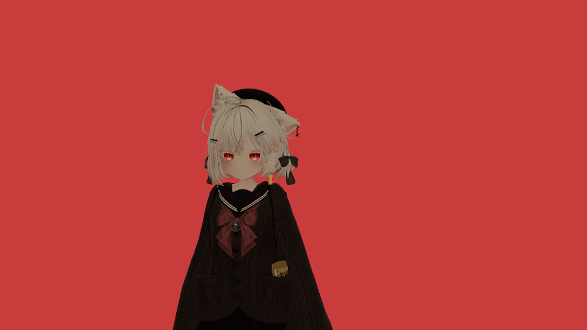

# VRChat Spout camera → macOS OBS over Syphon (FX Steam Launcher / DXMT)

Takes the **independent camera view** that VRChat publishes with Spout and shows it in **native macOS
OBS**, while VRChat keeps rendering through **DXMT**. No game modification, no launch-option change, no
OBS plugin, no window capture.



## How it works in one paragraph

FX Steam Launcher runs the SteamOS guest's Direct3D 11 through **DXMT**, whose `winemetal` layer is
executed by `libwmtr_host.dylib` **inside the `steamac-vm` process on macOS** (wmtr over virtio-gpu). A
D3D11 texture created with `D3D11_RESOURCE_MISC_SHARED` — exactly what Spout senders such as VRChat's
KlakSpout create — becomes an IOSurface-backed `MTLSharedTexture` in that process. A small dylib injected
into the launcher at start-up hooks the one Metal call that creates those textures
(`-[MTLDevice newSharedTextureWithDescriptor:]`) and republishes the texture through
**`SyphonMetalServer`**, which OBS's bundled `mac-syphon` source already understands. VRChat's camera
never leaves the GPU and the guest never copies pixels.

See [docs/ARCHITECTURE.md](docs/ARCHITECTURE.md) for the evidence and the rejected alternatives, and
[docs/VALIDATION.md](docs/VALIDATION.md) for what was actually measured.

## Status

| | |
| --- | --- |
| VRChat keeps DXMT | yes (guest, prefix, Proton and launch options untouched) |
| Independent camera view (not the game window) | yes, verified with the real VRChat Spout sender |
| OBS native, no plugin | yes (stock `mac-syphon` source) |
| Alpha | yes, preserved end-to-end (VRChat camera masks → OBS) |
| 1280×720 baseline | supported; VRChat's own "Stream Resolution" sets the size (verified at 1920×1080 and 1280×720) |
| 30 FPS | 30 fps publish cap, tuned by `fps=` in the live config |
| Guest-side CPU cost | none (the frame is published from the host process) |
| Measured | 30.0 fps mean to a Syphon client over 10 min at 1080p (worst gap 57.5 ms) and 5 min at 720p (worst gap 101.6 ms); OBS at 4.5–5.4 % CPU |

## Quick start

```bash
# 1. build (needs Xcode command line tools and /Applications/OBS.app for its Syphon.framework)
scripts/build.sh

# 2. start the launcher with the bridge injected (replaces a running launcher)
scripts/launch-with-bridge.sh

# 3. in VRChat: Camera -> Mode = Stream -> turn on "Spout Stream"
# 4. in OBS: add a "Syphon Client" source and pick "VRChat Spout Camera"
#    (scripts/pin-obs-source.sh does this for you and restarts OBS)
scripts/status.sh          # what the bridge is doing right now
```

`scripts/stability-run.py --minutes 10` records frame rate, gaps and resource use.

## Dependencies and versions (nothing upstream is patched)

| Component | Version / pin | Role |
| --- | --- | --- |
| FX Steam Launcher | 1.9.8 (unmodified) | hosts the VM; the dylib is injected at launch only |
| DXMT | upstream `e94c312f5c054263acf261cfa109edf13e757587` as shipped in 1.9.8 (unmodified) | produces the `MTLSharedTexture` we hook |
| OBS | 33.0.1 (unmodified) | supplies `mac-syphon` and the `Syphon.framework` (Syphon 5) we link |
| Syphon headers | Syphon-Framework `f476167` (BSD), in `vendor/syphon/Headers` | compile-time only; the runtime framework comes from OBS |
| mingw-w64 | 14.0.0 (Homebrew), optional | builds `spoutpair.exe`, the guest-side control experiment |

No patch to VRChat, Proton, FEX, DXMT, steamac or OBS is needed or applied.

## What is in the box

| Path | Purpose |
| --- | --- |
| `src/spoutsyphon.m` | the bridge dylib (Metal hook → Syphon publisher, live config) |
| `src/guest/spoutpair.c` | independent Spout-shaped sender/receiver used to validate the guest path without VRChat |
| `src/guest/run-probe.sh` | runs a Windows test exe in the guest with the game's exact DXMT environment |
| `src/syphon_test_send.m`, `src/syphon_test_recv.m`, `src/syphon_stats.m`, `src/syphon_list.m` | Syphon-side test and measurement tools |
| `src/hosttest.m` | minimal host process used to exercise the dylib without the VM |
| `src/windowid.m` | screenshot a single window (verification) |
| `scripts/` | build, launch, status, OBS pinning, guest transfer, stability run |
| `docs/` | architecture, install/rollback, validation record |

## Limits (see docs/VALIDATION.md for the measurements)

* Syphon is used in **copy** mode (one GPU blit per frame inside the VM process); there is no zero-copy
  publish API in Syphon.
* The bridge publishes at a fixed rate (default 30). If VRChat renders slower, frames repeat; the
  `update …/s` figure in the log is the measured source rate.
* If VRChat destroys the sender (camera closed, Spout off) the last frame stays on the Syphon server —
  the picture freezes rather than disappearing.
* `flip=1` is the default because OBS's Syphon source draws the IOSurface bottom-up. Other Syphon
  consumers may want `flip=0` (see `docs/INSTALL.md`).
* This is a per-launch injection. Launching FX Steam Launcher normally is always the rollback.
