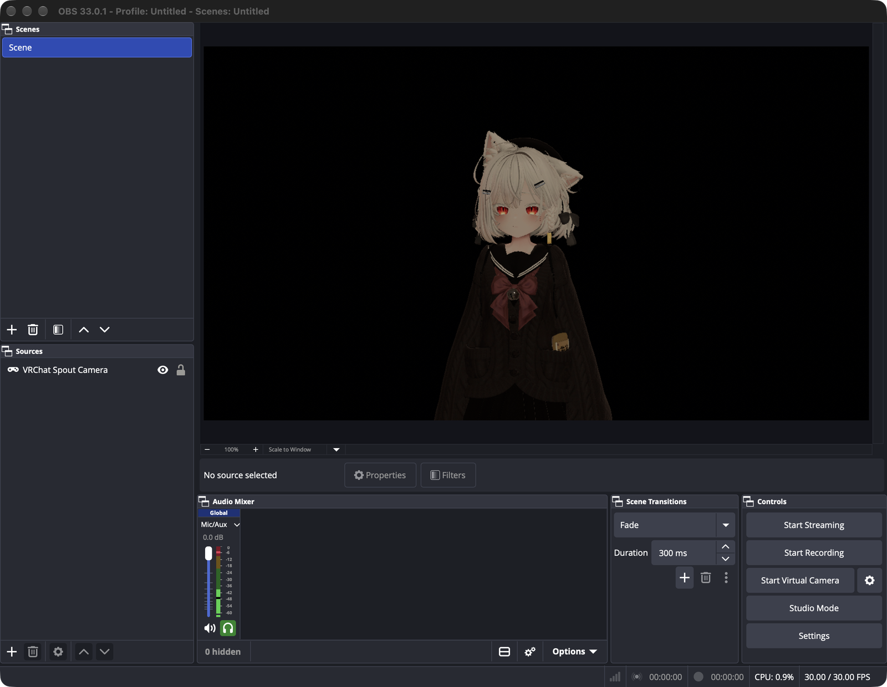

# VRChat Spout → macOS Syphon → native OBS (DXMT preserved)

Take the **independent camera view** that VRChat publishes through **Spout** inside an FX Steam Launcher
SteamOS VM and show it in **native macOS OBS** — without touching the game, the graphics path or the
launcher. VRChat keeps rendering through **DXMT**, you keep playing in the main view, and OBS receives the
separate camera feed (with alpha), not the game window and not the desktop.



> Verified on real hardware: Apple M5 / macOS 27.2 / FX Steam Launcher 1.9.8 / OBS 33.0.1 / VRChat on DXMT.
> Numbers are in [Measurements](#measurements); untested items are listed in [Limitations](#limitations--not-verified).

---

## Contents

- [The problem](#the-problem)
- [How it works](#how-it-works)
- [Test environment](#test-environment)
- [Installation](#installation)
- [Daily use](#daily-use)
- [Measurements](#measurements)
- [Recovery behaviour](#recovery-behaviour)
- [Limitations & not verified](#limitations--not-verified)
- [Rollback](#rollback)
- [Repository layout](#repository-layout)
- [Licence & third parties](#licence--third-parties)

---

## The problem

VRChat ships a native Spout output (Camera → Mode = Stream → "Spout Stream", sender name `VRCSender1`).
On Windows you pair it with `obs-spout2-plugin`. This machine is not Windows:

```
macOS (Apple M5)
└─ FX Steam Launcher 1.9.8
   └─ SteamOS VM (ARM64, virtio-gpu)
      └─ FEX + Proton Experimental
         └─ VRChat (Windows x86-64)
            └─ D3D11 = DXMT
```

Spout shares **Windows D3D11 textures**; macOS OBS only understands **Syphon** (IOSurface). Nothing
existing bridges the two here: `spout2pw` is archived and DXVK/Vulkan/DMA-BUF/PipeWire-only,
`obs-spout2-plugin` is Windows/D3D11-only, and `nozzle-spout-syphon` is an unimplemented scaffold.

This project closes that gap with a very thin bridge — and **no pixels ever cross the VM boundary**.

## How it works

### Key findings

1. **DXMT's Metal executor runs inside the `steamac-vm` process on macOS.**
   DXMT's `winemetal` forwards Metal calls over wmtr (virtio-gpu capset 30) to `libwmtr_host.dylib` in the
   host process, so every guest D3D11 texture already *is* a real Metal texture there.
2. **A Spout texture is a shared texture.** VRChat's bundled `KlakSpout.dll` uses
   `D3D11_RESOURCE_MISC_SHARED` + `IDXGIResource::GetSharedHandle` (checked against the shipped DLL's
   import table and IID table — no `IDXGIResource1` / NT handles).
3. **DXMT realises shared textures as IOSurface-backed `MTLSharedTexture`s.** The single entry point is
   `-[MTLDevice newSharedTextureWithDescriptor:]`
   (`src/winemetal/unix/winemetal_unix.c`: `newSharedTextureWithDescriptor` → `newSharedTextureHandle` →
   `createMachPort`).
4. **wmtr replaces the bootstrap name table with an in-process one.** The source says "the names reach every
   client and nothing outside", so an external process cannot resolve that Mach port — the hook has to live
   inside the VM process.

### The chain

```
VRChat camera (Spout Stream)
  └─ D3D11 texture (MISC_SHARED, RGBA8)
       └─ DXMT / winemetal ──wmtr / virtio-gpu──► macOS: steamac-vm process
            └─ MTLSharedTexture (IOSurface)
                 └─ libSpoutSyphon.dylib: hooks newSharedTextureWithDescriptor:
                      └─ SyphonMetalServer (one GPU blit into Syphon's IOSurface pool)
                           └─ OBS 33 built-in mac-syphon source
```

So there is **no guest readback, no encode, no network transfer and no guest CPU cost** — the whole path
stays on the same GPU.

### Rejected approaches

| Approach | Why not |
| --- | --- |
| Windows OBS + `obs-spout2-plugin` inside the guest | Not native macOS OBS; the plugin is Windows/D3D11-only |
| `spout2pw` (Spout → PipeWire) | Archived 2026-03; DXVK/Vulkan/DMA-BUF/PipeWire-only, x86-64, needs a patched Proton; none of that exists on macOS |
| Guest-side Spout receiver + socket/encode to macOS | Works in principle (DXMT does implement `OpenSharedResource`) but needs an FEX-emulated 3.6 MB/frame readback plus ~110 MB/s transport — high latency and CPU; kept only as a fallback |
| Hand the Spout Mach port to a helper process | wmtr keeps an in-process name table; external processes cannot resolve it |
| Window capture / record inside the VM | Explicitly a fallback only: it is not the independent camera view and it loses alpha |

---

## Test environment

Every version below was re-checked on this machine at the time of testing, not copied from earlier notes.

### Host

| Item | Value |
| --- | --- |
| Machine | Apple M5, 24 GB unified memory, arm64 |
| OS | macOS 27.2 (build 26B123) |
| Launcher | FX Steam Launcher **1.9.8** (`es.fxgam.steamac`, ad-hoc signed, **no hardened runtime**) |
| Launcher main executable | `Contents/MacOS/steamac-vm` (UI and VMM are one binary — the injection target) |
| OBS | **33.0.1** (bundle `40954849292`), ships `mac-syphon.plugin` + `Syphon.framework` (Syphon 5) |
| Build tools | Xcode Command Line Tools (`clang`); Homebrew optional |

### Virtual machine / game

| Item | Value |
| --- | --- |
| Guest | SteamOS `holo`, kernel `7.2.9-steamac`, reached through the launcher's SSH forward `127.0.0.1:2222` |
| Guest login | user `steamos`; password is the launcher-managed Keychain item `es.fxgam.steamac.guest-password` |
| Compatibility | Proton Experimental + FEX-Emu (x86-64 Wine on ARM64) |
| Graphics path | **DXMT** (`steamac.gfx=dxmt`). Evidence: VRChat log `GPU Apple M5 Direct3D 11.0 [level 11.1]`, and the 438100 prefix's `system32/d3d11.dll` is DXMT's 4,681,728-byte build |
| Metal executor | `libwmtr_host.dylib` mapped into `steamac-vm`; a test process prints `wmtr: connected: ring 12730368 bytes, 64 slots` |
| VRChat | Steam AppID 438100, ships `KlakSpout.dll` (966,656 B, sha256 `eaeeae32…`) |
| Camera settings | Camera → Mode = Stream → **Spout Stream** on; both 720p and 1080p Stream Resolution verified |

### Dependencies (nothing upstream is patched)

| Component | Version / pin | Role |
| --- | --- | --- |
| FX Steam Launcher | 1.9.8 (unmodified) | hosts the VM; the dylib is injected at launch only |
| DXMT | upstream `e94c312f5c054263acf261cfa109edf13e757587` as shipped in 1.9.8 (unmodified) | produces the `MTLSharedTexture` we hook |
| OBS | 33.0.1 (unmodified) | supplies `mac-syphon` and the runtime `Syphon.framework` |
| Syphon headers | Syphon-Framework `f476167` (BSD), see `vendor/syphon/Headers` | compile time only; the framework comes from OBS at runtime |
| mingw-w64 | 14.0.0 (Homebrew, optional) | builds the guest-side control experiment `spoutpair.exe` |

---

## Installation

### 0. Prerequisites

- Apple silicon Mac with **FX Steam Launcher 1.9.8**, **OBS 33.x** (for the Syphon framework) and the
  Xcode Command Line Tools (`xcode-select --install`).
- The launcher must be ad-hoc signed without hardened runtime (1.9.8 is). With hardened runtime or library
  validation, `DYLD_INSERT_LIBRARIES` is refused by the system — see [Limitations](#limitations--not-verified).
- No Steam launch options, Proton/FEX changes or guest-side installs are required.

### 1. Build

```bash
git clone https://github.com/ion-aluminium/vrchat-spout-syphon.git
cd vrchat-spout-syphon
scripts/build.sh
```

Output in `build/`:

- `libSpoutSyphon.dylib` — the bridge
- `syphon_stats`, `syphon_list`, `syphon_test_send`, `syphon_test_recv` — test and measurement tools
- `hosttest`, `windowid` — exercise the dylib without the VM, and screenshot a single window

`build.sh` links `/Applications/OBS.app/Contents/Frameworks/Syphon.framework` (the Syphon 5 that OBS
ships). Different location: `OBS_APP=/path/to/OBS.app scripts/build.sh`.

### 2. Start the launcher with the bridge injected

```bash
scripts/launch-with-bridge.sh          # asks before quitting a running launcher
scripts/launch-with-bridge.sh --yes    # no prompt
```

What it does: AppleScript `quit` on the launcher, then relaunch through
`open -a "FX Steam Launcher.app" --env DYLD_INSERT_LIBRARIES=…` with:

| Variable | Default | Meaning |
| --- | --- | --- |
| `SPOUTSYPHON_ENABLE` | `1` | without it the dylib does nothing |
| `SPOUTSYPHON_NAME` | `VRChat Spout Camera` | Syphon server name |
| `SPOUTSYPHON_FPS` | `30` | publish rate cap |
| `SPOUTSYPHON_FLIP` | `1` | vertical flip (OBS's Syphon drawing convention needs it) |
| `SPOUTSYPHON_LOG` | `/tmp/spoutsyphon.log` | log file |

The injection applies to this launch only. Nothing on disk changes: launcher bundle, SteamOS disk image,
Proton prefix and OBS installation are untouched.

### 3. Configure OBS

Manual (recommended for daily use): **Sources → + → Syphon Client →** pick **`VRChat Spout Camera`**.
OBS stores the name and app name and reconnects by name after a VM restart.

Scripted (what this project used for its verification screenshots; backs up the scene collection and
restarts OBS):

```bash
scripts/obs-add-syphon-source.py    # OBS must be closed; creates the source by name
scripts/pin-obs-source.sh           # reads name/app/uuid from the live server, writes them, restarts OBS
```

> ⚠️ OBS's `mac-syphon` only accepts a server announce when **both the app name and the server name match**
> (or the UUID matches). Syphon takes the app name from the server process's bundle — here
> **`FX Steam Launcher`**. Adding the source by hand fills this in for you; a source created
> programmatically without it stays black — run `scripts/pin-obs-source.sh`.

### 4. Turn Spout on in VRChat

Camera → **Mode = Stream** → turn on **Spout Stream**. Size comes from the camera's **Stream Resolution**
(720p / 1080p / 1440p / 2160p). The camera **Mask** toggles (World / Remote Player / UI…) decide what
becomes transparent: with World masked off the background is transparent and the alpha reaches OBS intact.

### 5. Verify

```bash
scripts/status.sh                 # launcher, dylib presence, log tail, Syphon server list
build/syphon_stats --seconds 10   # frames/s actually delivered, worst gap, size, mean RGBA (with A)
build/syphon_list                 # name / app / uuid of every Syphon server
```

The bridge logs one line per sender:

```
15:41:14.658 [36911] newSharedTexture 1280x720 fmt=RGBA8Unorm usage=0x5 storage=2 why=hook -> ACCEPTED
15:41:14.672 [36911] source switched to the live 1280x720 texture
```

---

## Daily use

1. Start the launcher through `scripts/launch-with-bridge.sh` (wrap it in a `.command` for a double-click).
2. Play normally; open the camera's Spout Stream and the feed appears.
3. The OBS Syphon source stays put and reconnects even after a VM restart.

**Live settings** — re-read once a second from `/tmp/spoutsyphon.conf`, no VM restart needed:

```ini
flip=1        # 0/1 vertical flip for the Syphon consumer (OBS wants 1)
fps=30        # publish rate cap
probe=1       # measure the source's real update rate with a small GPU readback
name=VRChat Spout Camera
```

Source selection is automatic: a newly created shared texture only becomes the published source once it is
observed to change, and a source that stops changing for 2 s is replaced by a newer live candidate. That is
what makes VRChat's resolution change (it destroys and recreates the sender) and unrelated small textures
(such as the 640×360 face-mirror helper) behave.

---

## Measurements

### Staged validation (test sender and real VRChat kept separate)

| Stage | Result |
| --- | --- |
| A — independent sender creates a shared texture | `CreateTexture2D MISC_SHARED` OK, `GetSharedHandle = 0x40000182` |
| B — second process opens it | `OpenSharedResource` OK, **146 distinct frames in 5 s**, corner colours and orientation correct |
| C/D — through the real VM into Syphon | hook logs `ACCEPTED`; Syphon client receives **175 frames in 6 s** |
| D — host-only Syphon isolation | publish → discover → receive, **146 frames in 5 s** |
| E — **real VRChat** | 30 fps at both 720p and 1080p; OBS shows the camera only, no window/UI |

Synthetic quadrants survive with the exact painted colours and orientation (red TL / green TR / blue BL /
white BR), which pins down channel order and vertical orientation independently of VRChat:


### Frame rate, drops, cost

| Metric | 1280×720 | 1920×1080 |
| --- | --- | --- |
| Duration | 5 min (291 s) | 10 min (579 s) |
| Frames received by a Syphon client | min 25.8 / **mean 30.0** / max 30.9 fps | min 29.1 / **mean 30.0** / max 31.1 fps |
| Worst inter-frame gap | 101.6 ms (one 3-frame hiccup in 291 s) | 57.5 ms |
| Source update rate (GPU probe) | 30.0/s | 30.0/s |
| OBS CPU | mean 5.4 %, peak 10.2 % | mean 4.5 %, peak 6.0 % |
| `steamac-vm` CPU (whole VM incl. game) | mean 111.6 % | mean 110.9 % |

Raw data: [`evidence/stability/`](evidence/stability).

### Colour, orientation, alpha

- Colour order: verified with the synthetic quadrants (red/green/blue/white); no channel swap.
- Orientation: OBS's Syphon source draws the IOSurface bottom-up, so the bridge publishes with `flip=1`;
  with `flip=0` OBS shows the image upside down.
- Alpha: with the camera's World mask off, received frames have **alpha 0–255**, and at 720p
  **86.8 % of pixels are fully transparent, 13.1 % fully opaque**. Composites over blue — the transparent
  area shows blue, not black:


### Latency

**Not measured optically**, so no "end-to-end X ms" claim. What can be bounded:

- publishing is paced at 30 fps, so a frame waits **≤ 33 ms** for the next publish tick (measured interval
  min 33.6 / mean 35.7 / max 57.5 ms — i.e. no queueing);
- the 720p publish is one sub-millisecond GPU blit plus Syphon's Mach-message hand-off;
- OBS then composites on its own 30 fps tick.

A true glass-to-glass figure needs an external camera filming source and display, or timestamp
instrumentation inside the guest.

---

## Recovery behaviour

| Scenario | Measured result |
| --- | --- |
| OBS quit and relaunched | reconnects by itself; 30.5 fps measured immediately after the restart |
| VM/launcher restarted (new Syphon UUID) | matches by name+app and reconnects |
| VRChat changes Stream Resolution (destroys and recreates the sender) | fixed: the first build kept publishing the dead texture (frozen frame, `update 0.0/s`); selection is now liveness-driven and switches to the new texture within 15 ms |
| Spout Stream switched off | the sender stops writing → `update 0.0/s`, the picture freezes on the last frame (by design, so the source does not vanish) |
| Spout Stream switched back on | the new live texture takes over about 15 ms after creation |

---

## Limitations & not verified

- **Glass-to-glass latency** was not measured optically (see above).
- **Multi-camera / Camera Dolly** (`VRCSender2+`, alpha on secondary cameras) is untested; the current rule
  is "newest live texture", so multi-stream would need a selection policy.
- **Other Spout senders** (browsers, media players) are untested.
- **Non-OBS Syphon clients**: `flip=1` is tuned for OBS; Syphon Recorder and friends were not tested.
- **Launcher updates**: if a future launcher enables hardened runtime or library validation,
  `DYLD_INSERT_LIBRARIES` will be refused. The fallback is to rebuild `libwmtr_host.dylib` with a
  texture-export call, like the VR path's `WMTVRSubmit` (designed, not implemented here).
- This repository does not modify or inject into VRChat, Easy Anti-Cheat, Proton, FEX, DXMT or OBS.

## Rollback

| Level | Action |
| --- | --- |
| Stop the bridge | Quit the launcher and start it normally from Finder/Dock. The injection is per launch |
| Remove the OBS source | Right-click `VRChat Spout Camera` in OBS → Remove, or restore an `Untitled.json.bak-spoutbridge-*` backup |
| Remove everything | Delete this repository. No system, launcher, guest or Proton file was changed |

Confirm the launcher is clean: `vmmap <steamac-vm pid> | grep SpoutSyphon` should print nothing.

## Repository layout

```
src/
  spoutsyphon.m              the bridge (Metal hook + Syphon publisher + liveness selection + live config)
  guest/spoutpair.c          Spout-shaped sender/receiver that does not need VRChat (control experiment)
  guest/run-probe.sh         runs a Windows test exe with the game's exact DXMT environment
  syphon_test_send.m         synthetic frames -> Syphon (isolation test)
  syphon_test_recv.m         Syphon receive + checks
  syphon_stats.m             frame rate / gap / size / mean RGBA measurement
  syphon_list.m              enumerate Syphon servers
  hosttest.m                 exercise the dylib without the VM
  windowid.m                 per-window screenshot (evidence capture)
scripts/
  build.sh                   build everything
  launch-with-bridge.sh      start the launcher with the bridge injected
  status.sh                  one-shot state check
  obs-add-syphon-source.py   edit the OBS scene collection (with automatic backup)
  pin-obs-source.sh          fix the OBS source from the live server and restart OBS
  stability-run.py           long-run measurement (frame rate / gaps / CPU / RSS -> CSV)
  guest-ssh.sh / guest-push.sh / guest-pull.sh   guest access and file transfer
docs/
  ARCHITECTURE.md            architecture and trade-offs, with source-level evidence
  INSTALL.md                 install / use / rollback / troubleshooting
  VALIDATION.md              validation record (what was measured, what was not)
evidence/                    screenshots and stability CSVs
```

## Licence & third parties

This repository's code is released under the **MIT** licence (see [LICENSE](LICENSE)). It contains no
upstream code and patches nothing upstream. At runtime it relies on third-party components under their own
licences:

- **Syphon** (BSD) — used through the `Syphon.framework` bundled with OBS; `vendor/syphon/Headers` holds
  Syphon-Framework headers and `vendor/syphon/License.txt` its licence.
- **OBS Studio** (GPL-2.0) — its built-in `mac-syphon` source is the consumer.
- **DXMT** (LGPL-2.1+) and **steamac / FX Steam Launcher** (GPL-3.0) — used as the runtime environment,
  unmodified.
